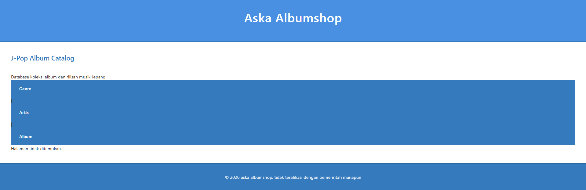
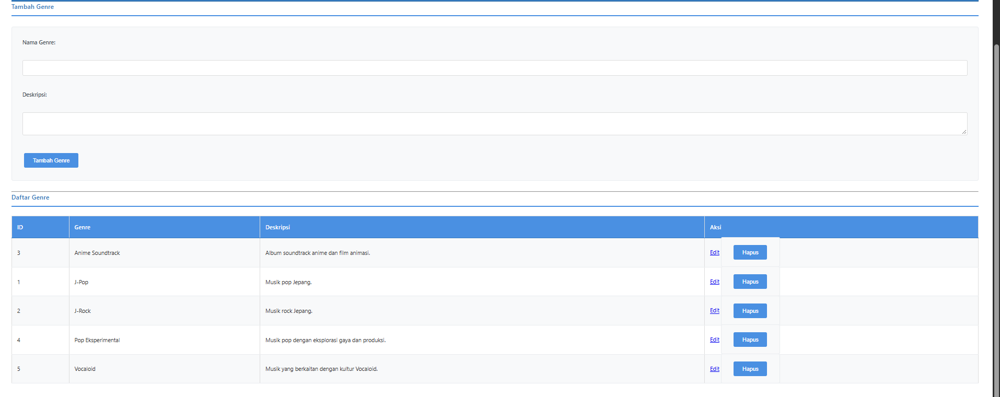
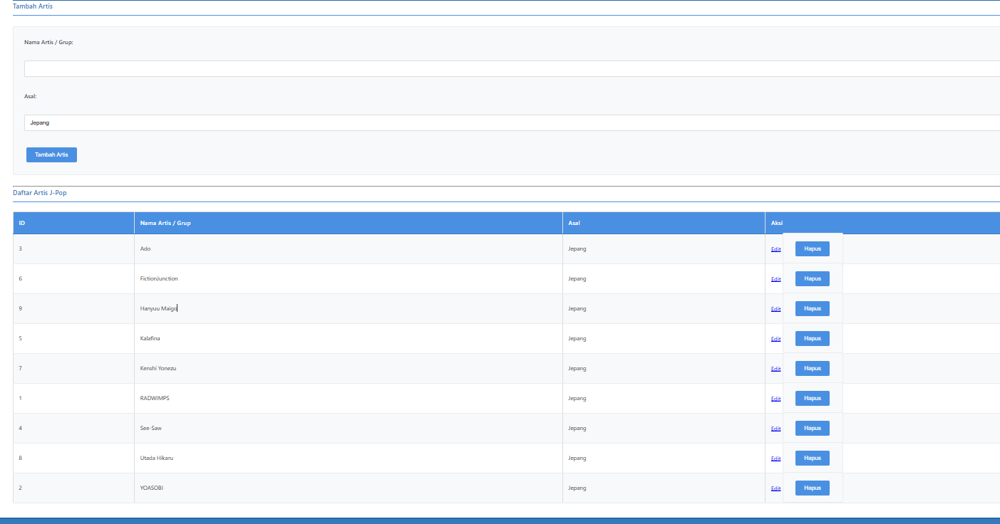
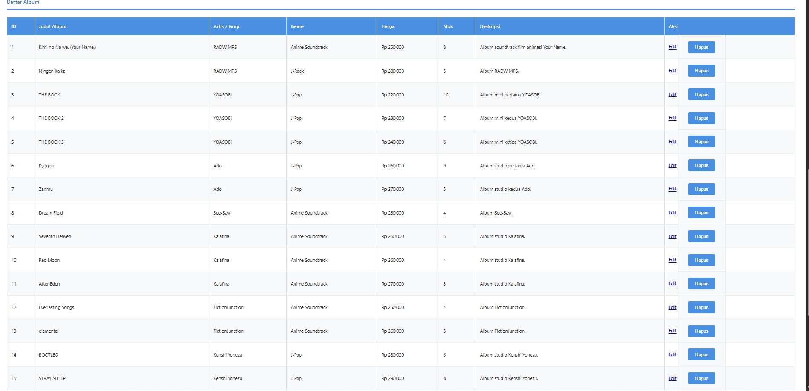
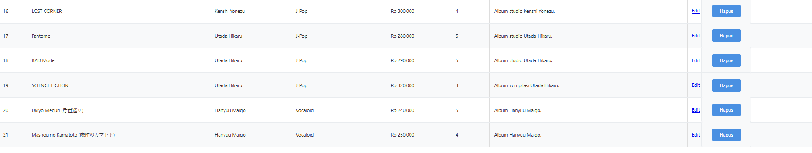
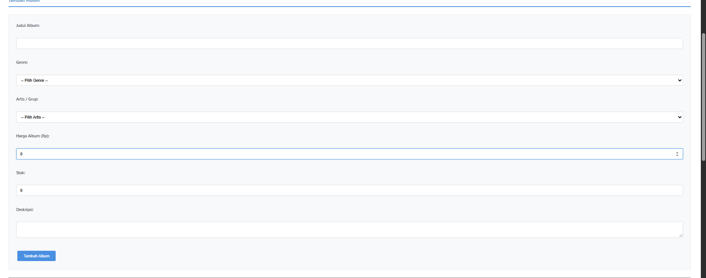
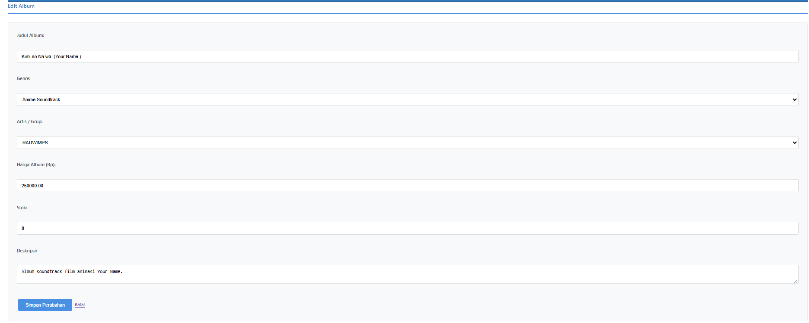
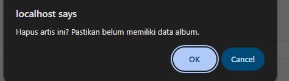
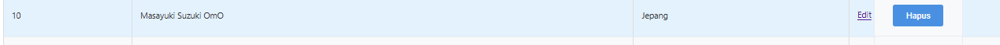
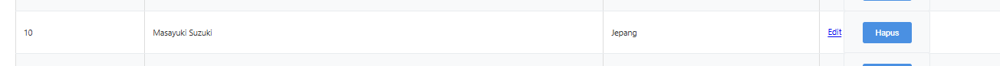

r# TP7DPBO2526C2

## Janji

Saya Nabil Azka Saputra dengan NIM 2507096 mengerjakan Tugas Praktikum 7 pada Mata Kuliah Desain dan Pemrograman Berorientasi Objek untuk keberkahan-Nya maka saya tidak melakukan kecurangan seperti yang telah dispesifikasikan. Aamiin.

## Penjelasan Program

Program yang dibuat merupakan **J-Pop Album Catalog**, yaitu aplikasi web sederhana untuk mengelola katalog album musik J-Pop. Aplikasi ini dikembangkan menggunakan PHP Native dengan konsep Object-Oriented Programming (OOP) dan database MySQL.

Aplikasi menyediakan fitur pengelolaan data genre, artis, dan album. Setiap data dapat ditambahkan, ditampilkan, diubah, dan dihapus melalui antarmuka aplikasi.

## Desain Program

Program menggunakan beberapa class yang masing-masing bertanggung jawab terhadap pengelolaan entitas tertentu.

1. **Class Genre**
   - Mengelola data genre musik.
   - Menyediakan fungsi tambah, tampil, cari, ubah, dan hapus genre.

2. **Class Artis**
   - Mengelola data artis atau penyanyi.
   - Menyediakan fungsi tambah, tampil, cari, ubah, dan hapus artis.

3. **Class Album**
   - Mengelola data album musik.
   - Menyediakan fungsi tambah, tampil, cari, ubah, dan hapus album.
   - Menggunakan relasi dengan tabel genre dan artis untuk menampilkan informasi album secara lengkap.

4. **Database**
   - Menggunakan MySQL sebagai penyimpanan data.
   - Koneksi database dikelola melalui `config/db.php`.
   - Seluruh operasi database menggunakan Prepared Statement untuk memproses query.

5. **File Utama dan View**
   - `index.php` menjadi pengatur alur utama aplikasi dan proses CRUD.
   - Folder `view/` berisi tampilan untuk halaman genre, artis, album, header, dan footer.
   - `style.css` digunakan untuk mengatur tampilan aplikasi.

## Struktur Database

Database yang digunakan bernama `db_jpop_album` dan terdiri dari tiga tabel utama:

1. **genre**
   - `id`
   - `nama_genre`
   - `deskripsi`

2. **artis**
   - `id`
   - `nama_artis`
   - `asal`

3. **album**
   - `id`
   - `id_genre`
   - `id_artis`
   - `judul_album`
   - `harga`
   - `stok`
   - `deskripsi`

Tabel `album` memiliki foreign key `id_genre` yang terhubung dengan tabel `genre`, serta `id_artis` yang terhubung dengan tabel `artis`.

## Alur Program

1. Pengguna membuka aplikasi melalui browser.
2. `index.php` memproses permintaan dan menentukan halaman yang akan ditampilkan.
3. Aplikasi menghubungkan diri ke database melalui `config/db.php`.
4. Class yang sesuai menjalankan operasi database menggunakan Prepared Statement.
5. Data ditampilkan melalui file pada folder `view/`.
6. Pengguna dapat melakukan operasi CRUD pada data genre, artis, maupun album.

## Fitur Aplikasi

- **Create:** Menambahkan data genre, artis, dan album.
- **Read:** Menampilkan daftar data dari masing-masing tabel.
- **Update:** Mengubah data yang sudah tersimpan.
- **Delete:** Menghapus data yang dipilih.
- **Relasi Data:** Menghubungkan album dengan genre dan artis.
- **Prepared Statement:** Menggunakan parameter query untuk operasi database.

## Dokumentasi

### 1. Halaman Utama

### 2. Halaman Genre

### 3. Halaman Artis

### 4. Halaman Album

### 4.1 Halaman Album

### 5. Form Tambah Data

### 6. Form Edit Data

### 7. Contoh CRUD (delete)

### 8. Contoh CRUD (Update)

### 9. Contoh CRUD (Create)

